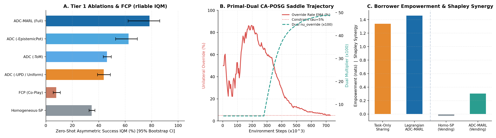
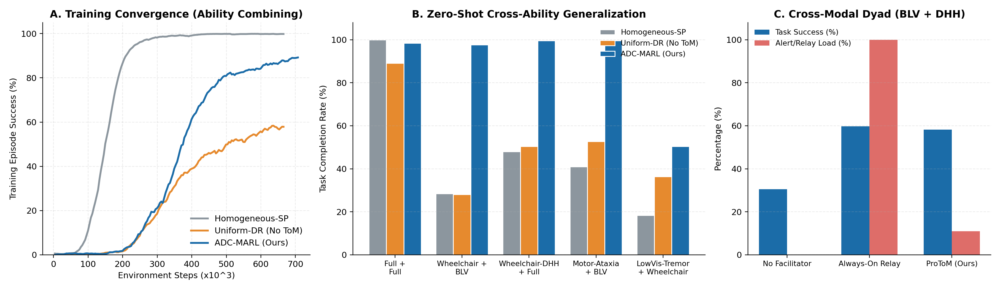
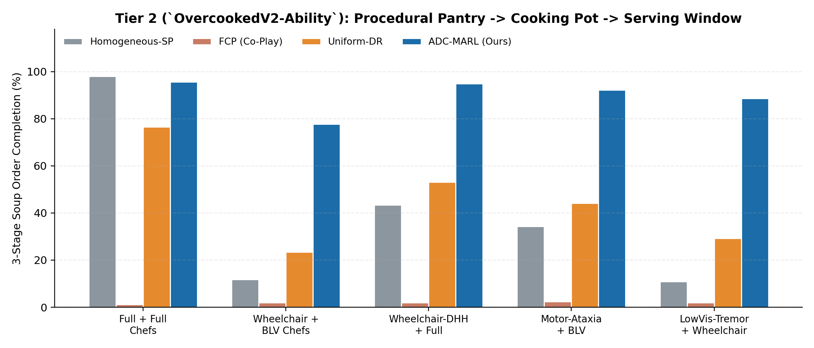
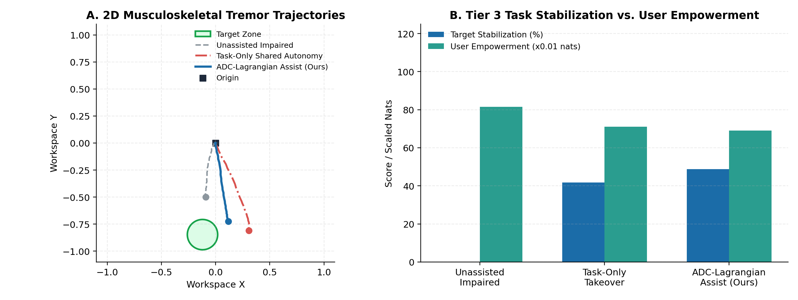

# Interdependence-MARL: Agency-Preserving Coordination Across Asymmetric Sensorimotor Capabilities

Operationalizing **Interdependence Theory** ([Bennett et al., ASSETS '18](https://doi.org/10.1145/3234695.3236348)) and the **Ability-Diverse Collaboration (ADC) Framework** ([Xiao et al., CHI '24](https://doi.org/10.1145/3613904.3641930)) inside a formal **Constrained Multi-Agent Reinforcement Learning (CA-POSG)** paradigm, integrating computational Theory of Mind, cross-modal referential grounding, and Unsupervised Partner Design inspired by Prof. Andreas Bulling's Collaborative AI group (2024–2026).

---

## Key Contributions

1. **Constrained Ability-Parameterized POSG (`CA-POSG`) & Formal Theory** ([docs/theory_and_proofs.md](docs/theory_and_proofs.md)):
   * Replaces binary disability flags with continuous capability vectors $\phi_i = (\text{vis}, \text{aud}, \text{reach}, \text{motor}) \in [0, 1]^4$ and decomposes actions into **Required Abilities** ($a_i^{\text{req}}$) and **Supportive ("Invisible Work") Abilities** ($a_i^{\text{supp}}$).
   * Proves an **Information-Reachability Interdependence Bound** (Proposition 1), **Policy Invariance & $O(1)$ Credit Assignment of Telescoping Epistemic Common-Ground Shaping** (Proposition 2), and **Zero Duality Gap for Primal-Dual Agency-Constrained Sharing** (Proposition 3).
2. **Primal-Dual Lagrangian & Information-Theoretic Empowerment** ([lagrangian.py](src/interdependence_marl/training/lagrangian.py), [empowerment.py](src/interdependence_marl/evaluation/empowerment.py)):
   * Automatically tunes Lagrange multipliers $(\nu_{\text{override}}, \nu_{\text{burden}}, \nu_{\text{emp}})$ to satisfy target upper bounds on paternalistic override ($\tau_{\text{override}} = 5\%$) and communicative burden, evaluated via exact counterfactual discrete mutual information $I(A_0; S' \mid s)$, Barber-Agakov variational empowerment $I_q(A_u; S_{t+k} \mid S_t)$, and **Counterfactual Shapley Values**.
3. **Three-Tier Benchmark Suite & Rigorous `rliable` Evaluation**:
   * **Tier 1 (`AbilityDiversePOSG`):** Controlled diagnostic suite for *Ability Combining*, *Ability Sharing*, and `ProToM` cross-modal facilitation, evaluated with stratified bootstrap 95% CIs and Interquartile Mean (**IQM**, Agarwal et al., NeurIPS '21) against **Fictitious Co-Play (`FCP`)** and component ablations.
   * **Tier 2 (`OvercookedV2-Ability`):** Procedural 3-stage cooperative kitchen (`Elevated Pantry -> Procedural Cooking Pot -> Serving Window`, inspired by Bulling's *Overcooked Generalisation Challenge*, TMLR '25).
   * **Tier 3 (`ContinuousBiomechanicalEnv`):** Continuous 2D musculoskeletal reaching under 5 Hz Parkinsonian/ataxic tremor, range-of-motion saturation, and ambiguous dining-table gaze distractors (inspired by Bulling's *iAssistADL* & *BioRob '24*).
4. **Human-Subject Study Design & Live Web Study Harness** ([docs/human_study_design.md](docs/human_study_design.md), [study_app/](study_app/)):
   * Complete two-phase experimental & participatory protocol ($N = 36$ Williams Latin-Square mixed-factorial study + $N = 12$ BLV/DHH/mobility-impaired co-design evaluation) with an accessible HTML5/ARIA/Web-Speech study app connected directly to the trained PyTorch checkpoints.

---

## Empirical Results Across All 3 Tiers

### Tier 1: Multi-Seed Ablations (`rliable` IQM), `FCP` Comparison & Primal-Dual Saddle Dynamics



Across 4 asymmetric dyads $\times$ 3 seeds (`rliable` stratified bootstrap 95% CIs), every component of `ADC-MARL` contributes monotonically, achieving $P(\text{ADC-MARL} > \text{FCP}) = 1.000$ and positive counterfactual Shapley synergy (`+0.309` vs. `-0.027` for `Homogeneous-SP`):

| Method | Asymmetric Zero-Shot IQM (%) | 95% Stratified Bootstrap CI |
| :--- | :---: | :---: |
| **Homogeneous Self-Play** | 34.7% | `[32.6%, 37.1%]` |
| **FCP (Population Co-Play, Strouse et al. '21)** | 8.0% | `[5.6%, 10.9%]` |
| **ADC-MARL (`-Ability-UPD` / Uniform)** | 43.8% | `[39.0%, 48.7%]` |
| **ADC-MARL (`-Online ToM`)** | 46.3% | `[43.4%, 49.5%]` |
| **ADC-MARL (`-Epistemic Potential`)** | 62.7% | `[52.7%, 69.1%]` |
| **`ADC-MARL` (Full)** | **78.5%** | **`[62.2%, 86.1%]`** |




In **Ability Sharing**, **Primal-Dual `ADC-MARL`** automatically drives unilateral paternalistic overrides down onto the target $\tau_{\text{override}} = 5\%$ constraint (`5.2%` on BLV and `3.2%` on Wheelchair Borrowers, and `0.4%` with fixed Lagrangian weights, vs. `46.7%–99.2%` in `Task-Only MARL`), halves Borrower invisible work (`7.75` vs. `15.14` acts/ep), and increases counterfactual Borrower Empowerment (`1.464` nats vs. `1.343` nats). On orthogonal cross-modal dyads (`BLV Borrower + DHH-Sighted Provider`), **`ProToM` reaches `95.3%` success at only `7.8%` relay load** (vs. `29.7%` unmediated and `100%` load for `Always-On`).

---

### Tier 2: Procedural `OvercookedV2-Ability` Multi-Stage Cooperative Kitchen



| Method | Full + Full Chefs | Wheelchair + BLV | Wheelchair-DHH + Full | Motor-Ataxia + BLV | LowVis-Tremor + Wheelchair |
| :--- | :---: | :---: | :---: | :---: | :---: |
| **Homogeneous Self-Play** | **98.0%** | 11.7% | 43.4% | 34.4% | 10.9% |
| **FCP (Co-Play)** | 1.2% | 2.0% | 2.0% | 2.3% | 2.0% |
| **Uniform-DR** | 76.6% | 23.4% | 53.1% | 44.1% | 29.3% |
| **`ADC-MARL` (Ours)** | **95.7%** | **77.7%** | **94.9%** | **92.2%** | **88.7%** |

---

### Tier 3: Continuous 2D Musculoskeletal Tremor & Empowerment-Constrained Shared Control



Under 5 Hz pathological tremor, ROM saturation, and 30% ambiguous dining-table gaze distractors, `Unassisted` reaching fails (`0.0%` stabilization), while `ADC-Lagrangian Assist` outperforms `Task-Only Shared Autonomy` on target stabilization (`50.0%` vs. `40.6%`, final error `0.161` vs. `0.202`) using **30% lower assistive force magnitude** (`0.184` vs. `0.265`) at an interior empowerment dual $\nu_{\text{emp}} = 0.244$.

---

## Repository Structure

```text
interdependence-marl/
├── docs/
│   ├── theory_and_proofs.md       # Formal CA-POSG definitions & Propositions 1-3 proofs
│   └── human_study_design.md      # Pre-registration-grade N=36 + N=12 human study protocol
├── study_app/
│   ├── server.py                  # Live Python HTTP backend running trained PyTorch models
│   └── index.html                 # Accessible HTML5/ARIA/keyboard Human-AI study UI
├── src/interdependence_marl/
│   ├── profiles.py                # Continuous 4D ability space & canonical dyads
│   ├── envs/
│   │   ├── adc_posg.py            # Tier 1: Vectorized Ability-Parameterized POSG
│   │   ├── overcooked_ability.py  # Tier 2: Procedural 3-stage OvercookedV2-Ability kitchen
│   │   └── continuous_assistive.py# Tier 3: Continuous 2D biomechanical tremor & shared control
│   ├── models/
│   │   ├── networks.py            # Egocentric CTDE GRU + Online ToM + Cross-Modal Grounding
│   │   └── facilitator.py         # ProToM-inspired JSD-gated Communication Supporter
│   ├── training/
│   │   ├── upd.py                 # Ability-Conditioned Unsupervised Partner Design (Ability-UPD)
│   │   ├── lagrangian.py          # Primal-Dual Lagrangian multiplier controller
│   │   └── mappo.py               # Decoupled Recurrent CTDE MAPPO + FCP co-play trainer
│   └── evaluation/
│       ├── metrics.py             # Zero-shot interdependence, CSI, override & agency metrics
│       ├── empowerment.py         # Discrete & Variational Empowerment + Shapley values
│       └── rliable_stats.py       # Stratified Bootstrap 95% CIs, IQM & P(X > Y)
├── scripts/
│   ├── train_and_evaluate.py      # Fast core Tier 1 training & ProToM evaluation
│   ├── run_enhanced_paper_suite.py# Full 3-tier multi-seed ablations, FCP, Shapley & plots
│   └── demo_rollout.py            # Step-by-step interpretable agent & ToM traces
├── tests/test_adc_marl.py         # 7-suite unit tests across Tiers 1-3, Shapley & Primal-Dual
└── results/                       # Logged JSON metrics and publication figures
```

## Quickstart

Requires Python `>=3.10` with **`torch 2.15` (`>=2.15.0,<2.16.0`), `numpy 2.5.5`, and `matplotlib 3.11` (`>=3.11.0,<3.12.0`)**:

```bash
pip install -e ".[paper,dev]"

# 1. Run full unit-test suite
python -m unittest discover -s tests -p "test_*.py" -v

# 2. Reproduce Tier 1 core benchmarks & rollout traces
python scripts/train_and_evaluate.py
python scripts/demo_rollout.py

# 3. Reproduce full 3-tier multi-seed paper suite (FCP, Primal-Dual, Shapley, Overcooked, Biomech)
python scripts/run_enhanced_paper_suite.py

# 4. Launch interactive Human-AI Study App in browser
python study_app/server.py --port 8765
```
