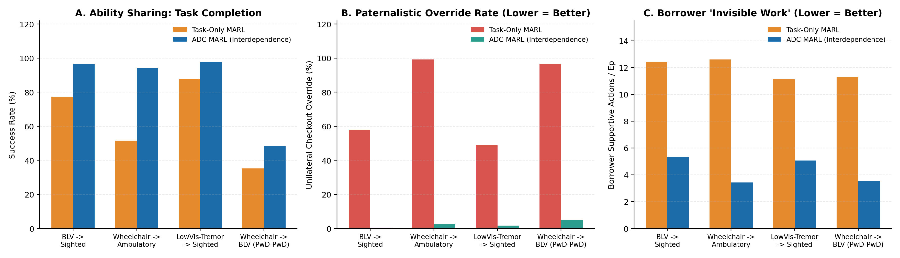

# Interdependence-MARL: Ability-Diverse Collaboration via Multi-Agent Reinforcement Learning

Operationalizing **Interdependence Theory** ([Bennett et al., ASSETS '18](https://doi.org/10.1145/3234695.3236348)) and the **Ability-Diverse Collaboration (ADC) Framework** ([Xiao et al., CHI '24](https://doi.org/10.1145/3613904.3641930)) inside a formal **Multi-Agent Reinforcement Learning (MARL)** paradigm, integrating computational Theory of Mind, cross-modal referential grounding, and Unsupervised Partner Design inspired by Prof. Andreas Bulling's Collaborative AI group (2024–2026).

---

## Overview & Motivation

Standard cooperative MARL assumes symmetric observation spaces, homogeneous action spaces, and a single task-completion scalar reward. As shown by Xiao et al. (CHI '24), ability-diverse human–human and human–AI collaborations violate all three assumptions:
1. **Asymmetric Sensory & Motor Capabilities:** Collaborators possess distinct perceptual channels and physical/cognitive envelopes ($\phi_i \in [0, 1]^d$).
2. **Active Supportive ("Invisible") Work:** Even when a goal belongs to one collaborator (*Ability Sharing*), the *Ability Borrower* is **not** a passive recipient of care—they actively deploy *Supportive Abilities* ($a_i^{\text{supp}}$) to build common ground and steer the *Required Ability* ($a_j^{\text{req}}$).
3. **Agency vs. Paternalistic Override:** Optimizing task return alone incentivizes capable agents to unilaterally take over tasks (*paternalistic override*) or force impaired partners to expend excessive communicative effort (*invisible work*).

This repository formalizes and trains **ADC-MARL** inside a fast, batched PyTorch **Ability-Parameterized Partially Observable Stochastic Game (A-POSG)** covering both ADC collaboration topologies (**Ability Combining** and **Ability Sharing**) and assistive **Communication Supporters**.

---

## Mathematical Formalization

We define an **Ability-Parameterized POSG**:

$$\mathcal{M} = \left\langle \mathcal{N}, \mathcal{S}, \{\phi_i\}_{i \in \mathcal{N}}, \left\{\mathcal{A}_i^{\text{req}} \times \mathcal{A}_i^{\text{supp}}\right\}_{i \in \mathcal{N}}, \{\Omega_i, O_i(\cdot \mid \phi_i)\}_{i \in \mathcal{N}}, T(\cdot \mid \{\phi_i\}), \{R_i\}_{i \in \mathcal{N}}, \gamma \right\rangle$$

* **Continuous Ability Profiles ($\phi_i \in [0, 1]^4$):** Rather than binary deficit flags (following Ability-Based Design; Wobbrock et al., 2011; Nolte et al., 2022), each agent has continuous `[vis, aud, reach, motor]` capabilities governing visual label perception, auditory/vocal perception, elevated dispenser actuation, and motor execution slip/tremor (`1 - motor`, following Charaja, ..., Bulling, et al., BioRob '24).
* **Dual-Head Action Space:** Each agent outputs $a_i = (a_i^{\text{req}}, a_i^{\text{supp}})$, separating physical domain actions (`STAY, UP, DOWN, LEFT, RIGHT, INTERACT`) from multimodal epistemic/grounding actions (`silent`, `vocal:0..2`, `gest:0..2`).
* **Online Theory-of-Mind Capability & Belief Inference** *(inspired by MToMnet, Bortoletto, Ruhdorfer, Shi, & Bulling, ECAI '24)*: Partner profiles $\phi_{-i}$ are **strictly hidden** at execution time; a decentralized recurrent encoder infers $(\hat{\phi}_{-i}^t, \hat{b}_i^t)$ online from interaction history $\tau_i^t$.
* **Collapse-Free Cross-Modal Grounding & Epistemic Common-Ground Potential** *(inspired by MATE, Benintendi, Ruhdorfer, Kögel, & Bulling, '26)*: Grounds latent station attention across sensory modalities and shapes common-ground formation via a policy-invariant telescoping potential $\Delta \Phi_{\text{bel}}(t) = \gamma \Phi_{\text{bel}}(t+1) - \Phi_{\text{bel}}(t)$.
* **Ability-Conditioned Unsupervised Partner Design (`Ability-UPD`)** *(extending Ruhdorfer, Bortoletto, Oei, Penzkofer, & Bulling, ICML '26)*: Dynamically curates continuous asymmetric ability dyads $(\phi_0, \phi_1) \in \Phi^2$ and stochastic policy-mixing weights prioritized by GAE advantage variance (the agent's learnability frontier).
* **ProToM-Style Communication Supporter** *(extending Bortoletto et al., Findings of ACL '26 & Xiao et al., Fig. 7d)*: Selectively translates vocal $\leftrightarrow$ visual/caption symbols across orthogonal sensory chasms (e.g., Blind-Hearing + Deaf-Sighted) **only** when inter-agent Jensen-Shannon belief divergence exceeds a threshold.

---

## Empirical Results

### 1. Ability Combining: Zero-Shot Cross-Ability Generalization


In the canonical **Wheelchair-Sighted + BLV-Ambulatory** vending-machine scenario (Bennett et al., 2018), neither collaborator can solve the task solo (`Wheelchair` has `0%` solo reach on elevated dispensers; `BLV` has `<= 33.3%` blind-guessing ceiling):

| Method | Full + Full | Wheelchair + BLV | Wheelchair-DHH + Full | Motor-Ataxia + BLV | LowVis-Tremor + Wheelchair |
| :--- | :---: | :---: | :---: | :---: | :---: |
| **Homogeneous Self-Play** | **100.0%** | 28.5% | 48.0% | 41.0% | 18.4% |
| **Uniform-DR (No ToM)** | 89.1% | 28.1% | 50.4% | 52.7% | 36.3% |
| **ADC-MARL (Ours)** | **98.4%** | **97.7%** | **99.6%** | **99.6%** | **50.4%** |

### 2. Ability Sharing: Preserving Borrower Agency & Reducing "Invisible Work"



When goal ownership belongs privately to the **Ability Borrower**, standard task-only MARL learns high rates of **paternalistic unilateral checkout override** (up to `99.2%`) and forces Borrowers to spam supportive utterances (`>12` actions/episode). Optimizing the **Interdependence Objective** increases task completion while eliminating unilateral overrides and halving Borrower communicative burden:

| Ability-Sharing Dyad | Metric | Task-Only MARL | ADC-MARL (Ours) |
| :--- | :--- | :---: | :---: |
| **BLV Borrower $\to$ Sighted Provider** | Success Rate | 77.3% | **96.5%** |
| | Unilateral Override Rate $\downarrow$ | 58.1% | **0.4%** |
| | Borrower Invisible Work (acts/ep) $\downarrow$ | 12.43 | **5.32** |
| **Wheelchair Borrower $\to$ Ambulatory Provider** | Success Rate | 51.6% | **94.1%** |
| | Unilateral Override Rate $\downarrow$ | 99.2% | **2.5%** |
| | Borrower Invisible Work (acts/ep) $\downarrow$ | 12.62 | **3.42** |
| **Wheelchair-DHH Borrower $\to$ Sighted Provider** | Success Rate | 47.7% | **91.4%** |
| | Unilateral Override Rate $\downarrow$ | 95.1% | **3.8%** |
| | Borrower Invisible Work (acts/ep) $\downarrow$ | 13.23 | **4.11** |

### 3. Bridging Orthogonal Sensory Modalities via `ProToM` Facilitator

On the **BLV Borrower + DHH-Sighted Provider** dyad (Xiao et al., Sec. 5.3.2—where direct vocal and visual channels have zero overlap):
* **No Facilitator (`none`):** `29.7%` task success (`0.0%` relay load)
* **Unfiltered Broadcast (`always_on`):** `77.3%` task success (`100.0%` notification load)
* **`ProToM` Selective Facilitator (`protom`):** **`95.3%` task success at only `7.8%` relay load** ($12.8\times$ lower alert burden)

---

## Repository Structure

```text
interdependence-marl/
├── src/interdependence_marl/
│   ├── profiles.py            # Continuous 4D ability space & canonical dyads
│   ├── envs/adc_posg.py       # Vectorized PyTorch Ability-Parameterized POSG
│   ├── models/networks.py     # Egocentric CTDE GRU + Online ToM + Cross-Modal Grounding
│   ├── models/facilitator.py  # ProToM-inspired JSD-gated Communication Supporter
│   ├── training/upd.py        # Ability-Conditioned Unsupervised Partner Design (Ability-UPD)
│   ├── training/mappo.py      # Decoupled Recurrent CTDE MAPPO trainer
│   └── evaluation/metrics.py  # Zero-shot interdependence, CSI, override & agency metrics
├── scripts/
│   ├── train_and_evaluate.py  # Reproduces all benchmarks, ablations, JSON logs, and plots
│   └── demo_rollout.py        # Prints step-by-step interpretable agent & ToM traces
├── tests/test_adc_marl.py     # Unit tests for sensory masking, supermodularity, ProToM & UPD
└── results/                   # Saved metrics JSON and publication figures
```

## Quickstart

```bash
# Install in editable mode (requires Python >= 3.10, PyTorch, NumPy, Matplotlib)
pip install -e .

# Run unit tests
python -m unittest discover -s tests -p "test_*.py" -v

# Reproduce full training & ablation benchmarks + figures
python scripts/train_and_evaluate.py

# Inspect step-by-step rollout traces & online partner capability inference
python scripts/demo_rollout.py
```

## Key References

* **Xiao et al. (CHI '24):** *A Systematic Review of Ability-diverse Collaboration through Ability-based Lens in HCI.*
* **Bennett et al. (ASSETS '18):** *Interdependence as a Frame for Assistive Technology Research and Design.*
* **Ruhdorfer, Bortoletto, Oei, Penzkofer, & Bulling (ICML '26):** *Unsupervised Partner Design Enables Robust Ad-hoc Teamwork.*
* **Bortoletto, Ruhdorfer, Shi, & Bulling (ECAI '24):** *Explicit Modelling of Theory of Mind for Belief Prediction in Nonverbal Social Interactions (MToMnet).*
* **Bortoletto et al. (Findings of ACL '26):** *ProToM: Promoting Prosocial Behaviour via Theory of Mind-Informed Feedback.*
* **Benintendi, Ruhdorfer, Kögel, & Bulling ('26):** *Grounded Joint-Attention Other-Play for Zero-Shot Coordination (MATE).*
